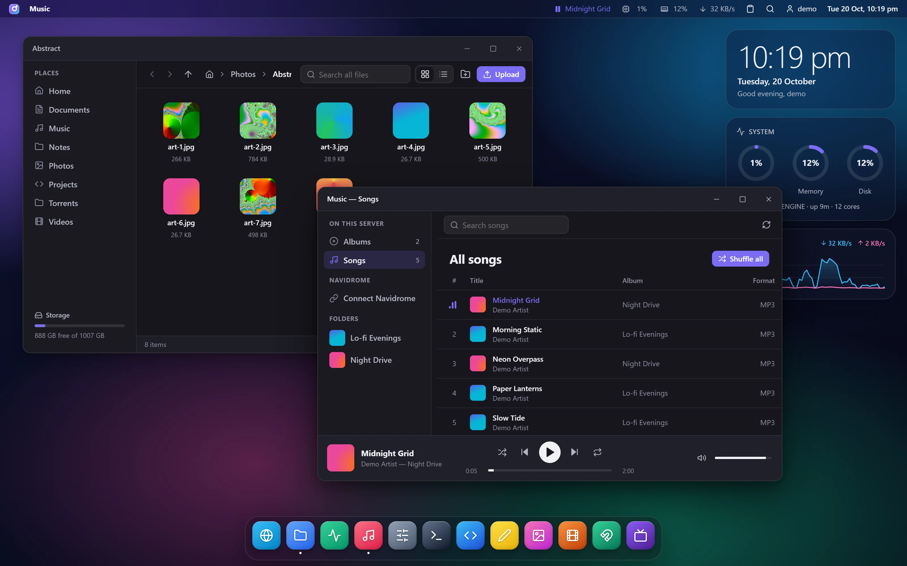
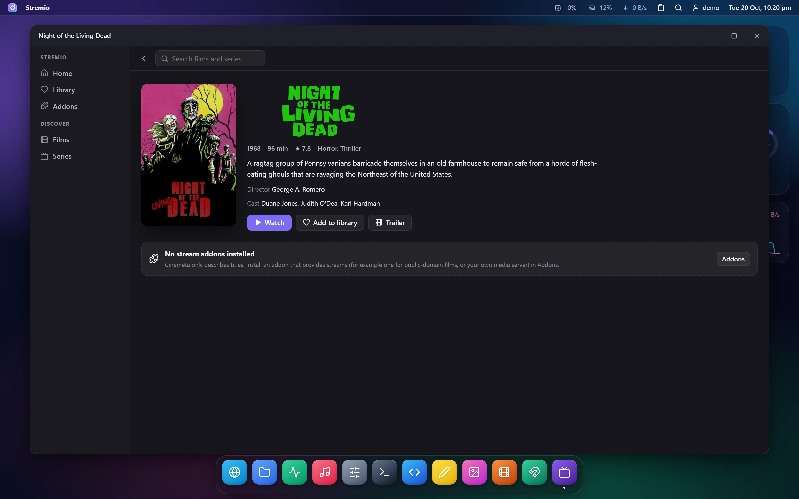
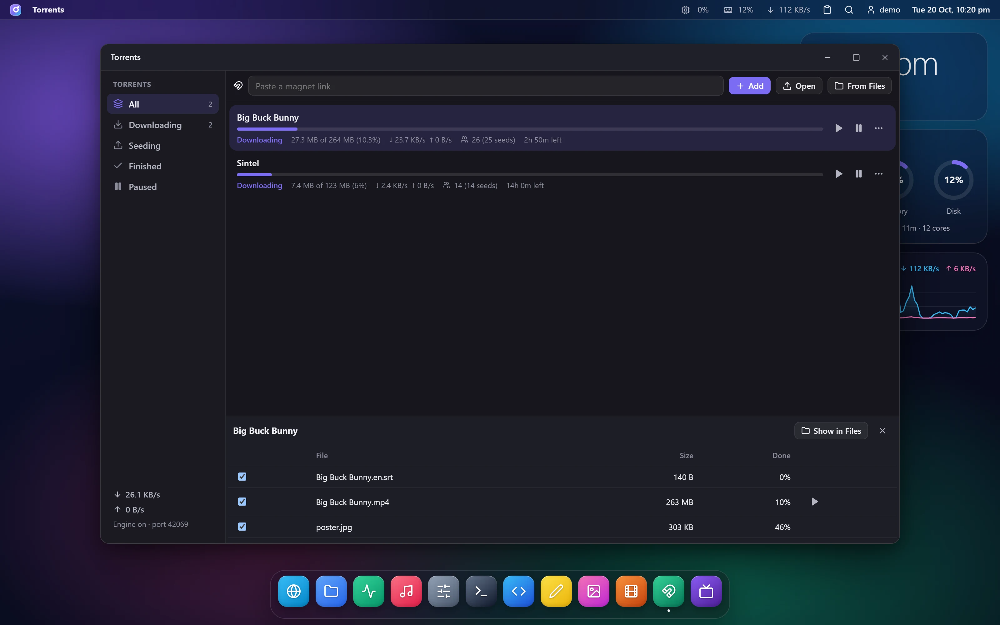
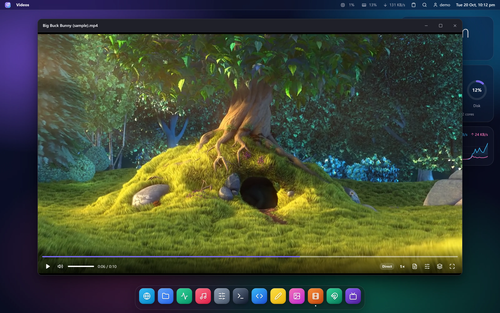
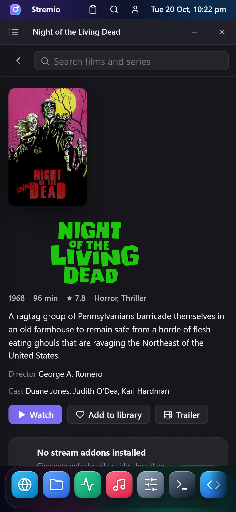

# ultraspace

> **Bored of plain SSH to your server? Try ultraspace — your friendly neighbourhood Go application.**

**Any Linux box, as a desktop in the browser.** ultraspace is a single Go binary that turns a home server, a
Raspberry Pi, an old laptop in a cupboard or a cloud VPS into a personal web desktop: files, system monitor,
music player, a real web browser, a terminal, VS Code, a torrent client and a Stremio-compatible media centre —
all in windows you can drag, snap and resize, from any device on your network (or anywhere, if you want).

No desktop environment on the server: no X11 or Wayland, no VNC, no xrdp, no remote-desktop client to install.
Copy one file, start it, open a browser. That is the whole idea — a usable interface for the machines in your
home lab, without turning them into a workstation.

Sign in on your laptop, close the lid, open your phone: the same windows, tabs, terminal sessions,
song and position are waiting for you.



```
┌──────────────────────────────────────────────────────────────────────┐
│ ◉ Files                          ▣ 6%  ▤ 41%  ↓ 120 KB/s  🔍  user  12:04 │
│  ┌─────────────── Files ───────────────┐   ┌──── Terminal ────────┐   │
│  │ Places   ‹ › ↑  Home › Music        │   │ me@server:~$ go test │   │
│  │ Home     ▢ Lo-fi   ▢ Night Drive    │   │ ok  ultraspace 1.2s  │   │
│  │ Music    ▢ cover.jpg                │   │ me@server:~$ █       │   │
│  └─────────────────────────────────────┘   └──────────────────────┘   │
│                  [ 🌐 ][ 📁 ][ 📈 ][ 🎵 ][ ⚙ ][ >_ ][ ‹› ]             │
└──────────────────────────────────────────────────────────────────────┘
```

- **One binary**, no runtime dependencies, no build step for the frontend. ~27 MB on disk, ~15 MB of RAM idle.
- **Runs where your machines are**: on your local network with nothing else, or on a VPS behind HTTPS. A
  cloud server is entirely optional.
- **Desktop UI**: lock screen, menu bar with live stats, dock, widgets, Ctrl+K launcher, light/dark themes, wallpapers.
- **Follows you everywhere**: the workspace is saved on the server and restored on any device.
- **Heavy parts start on demand**: Chrome, VS Code and the torrent engine run only while needed and stop when idle.
- **Security first**: setup token, hashed sliding sessions, CSRF and origin checks, strict CSP, systemd sandboxing,
  and an egress filter on the remote browser.

---

## Screenshots

| | |
| --- | --- |
|  |  |
| **Stremio** — catalogs, title pages, streams from your addons | **Torrents** — download into Files, play while downloading |
|  |  |
| **Videos** — plays almost any format, converting on the server when needed | **Phones** — full-screen windows, drawers and touch sizes |

<sub>Shown: *Big Buck Bunny* and *Sintel* © Blender Foundation (CC BY 3.0), *Night of the Living Dead* (1968, public
domain); title artwork from Stremio's Cinemeta. Photos and music in the demo are generated.</sub>

---

## Where it runs

| Setup | What you need | Good for |
| --- | --- | --- |
| **Home network** (simplest) | the binary, `listen = "0.0.0.0:4600"` | a home server, NAS box, Raspberry Pi or old PC; open `http://<its-ip>:4600` from any device at home |
| **Home network + HTTPS** | add Caddy/nginx with a local certificate, or Tailscale (`tailscale serve`) | the same, with every browser feature on and access from outside home over your tailnet |
| **VPS** | nginx + a domain + Let's Encrypt (steps below) | a machine that is always on and reachable from anywhere |

- **Machines**: Linux on x86-64 or arm64 (Raspberry Pi 4/5 with a 64-bit OS), from 512 MB of RAM. On ARM boards
  everything works except the server browser, because Chrome for Testing has no Linux ARM build (the Browser
  app uses light mode there).
- **No HTTPS?** Fine on a trusted home network. Browsers only allow a few features on secure pages, so copy
  buttons (clipboard) and some media keys need HTTPS or `localhost`; everything else works over plain HTTP.
- **Away from home** without opening ports: put the machine on [Tailscale](https://tailscale.com) (or WireGuard)
  and use its tailnet address; `tailscale serve` also gives you HTTPS.
- The server Browser, Stremio and the torrent engine deliberately refuse private addresses, so the box itself
  and your LAN cannot be reached through them. To open your router or NAS pages, use your own browser.

---

## Contents

- [Screenshots](#screenshots)
- [Where it runs](#where-it-runs)
- [Apps](#apps)
- [How it works](#how-it-works)
- [Security model](#security-model)
- [Requirements](#requirements)
- [Quick start (local)](#quick-start-local)
- [Home lab / local network](#home-lab--local-network)
- [Installing on a server](#installing-on-a-server)
- [Configuration](#configuration)
- [Using it](#using-it)
- [Resource usage](#resource-usage)
- [Development](#development)
- [HTTP API](#http-api)
- [Limitations](#limitations)
- [Credits](#credits)

---

## Apps

### Desktop

- **Lock screen** with clock; first run asks for a one-time setup token from the server.
- **Menu bar**: focused app, now playing, CPU / memory / network, shared clipboard, search, account, clock.
- **Dock** with running indicators; it scrolls sideways (swipe, or mouse wheel) when the apps do not fit, with a
  fade on the side that has more. **Widgets** for the clock, system rings and a live network graph.
- **Windows**: drag, resize from any edge, double-click to maximize, drag to the top or sides to snap, minimize to the dock.
  Each app remembers its size and position. Minimise, maximise and close sit on the right, Windows style; Settings →
  Appearance → *Window buttons* switches to macOS-style buttons on the left.
- **Launcher (Ctrl+K)**: apps, files anywhere in your library, and web addresses or searches for the Browser.
- **Appearance**: light, dark or auto theme, 10 accent colours, 8 built-in wallpapers or any image from Files,
  frosted-glass effects (can be turned off on slow devices).
- **Phones** (screens under 760 px; the desktop layout is untouched):
  - windows go full screen, and a ☰ button in the title bar slides an app's sidebar in as a drawer (Files places,
    System tabs, Music and Navidrome, the Notes list, Settings sections, Photo folders);
  - menus open as a sheet from the bottom, notifications appear above the dock, rows and buttons are sized for
    fingers, and text fields are 16 px so iPhones do not zoom;
  - a long press opens context menus (on iPhone and iPad too, which have no right-click event);
  - the Terminal adds a row of Esc / Tab / Ctrl / arrow keys, and the server Browser lays pages out for a phone.

### Files

A file manager confined to one folder on the server.

- Grid with image thumbnails or a list; breadcrumbs, back / forward / up, places sidebar, storage meter.
- Multi-select (Ctrl / Shift), right-click menus, keyboard shortcuts (Delete, F2, Enter, Backspace, Ctrl+A).
- Drag files onto folders to move them; drop files from your computer to upload (with progress and speed).
- Search across the whole library; *Set as wallpaper* for images; *Play in Music* for audio.
- **Between this computer and the server**: drop files onto a Files window (or the empty desktop) to upload, paste
  files with Ctrl+V into the open folder, and drag a file out of Files onto your computer's desktop to download it
  (Chrome and Edge). Music and Notes accept dropped audio and `.md`/`.txt` files too.
- Opens images and videos in the **Viewer**, audio in **Music**, text and code in the **Text Editor**.

### System

- Live CPU, memory and network charts (history kept on the server, so the graph is full when you open it).
- Disk usage, uptime, load, kernel and host information.
- **Processes**: sortable, filterable, refreshed every few seconds.
- **Services**: every systemd unit with its state, filter for failed units, and the unit's journal side by side.
- **Logs**: the system journal, filtered by priority, live.

Read-only by design: ultraspace itself runs unprivileged and cannot start or stop services.

### Music

One player for two libraries.

- **On this server**: audio files anywhere in Files. Each folder becomes an album, a `cover.jpg` / `folder.png`
  inside it becomes the artwork, and names like `01 - Artist - Title.mp3` are parsed into track, artist and title.
- **Navidrome** (or any Subsonic-compatible server): albums sorted by recently added / A–Z / most played /
  recently played / favourites / random, artists, playlists, favourites, *Mix for me*, and search.
  Hearts and play counts sync back to Navidrome.
- Player: shuffle, repeat (all / one), seeking, volume, keyboard shortcuts, and media keys / lock-screen
  controls through the Media Session API.
- The queue, track and position are part of your session: switch devices and pick up where you left off.

Navidrome credentials are entered once in the app. The server stores only a salted Subsonic token (never the
password), never sends it to the browser, and relays only listening-related API calls.

### Browser

Two engines, switchable from the ⋯ menu:

- **Server browser (default when installed)**: a real Chrome (`chrome-headless-shell`) runs on the server.
  Its screen is streamed to your window as JPEG frames over a WebSocket; mouse, wheel, keyboard, touch, paste and
  copy are sent back.
  - Every site works (GitHub, YouTube, sign-in pages…), because it is a real browser.
  - Cookies, logins, tabs and history live on the server, so they follow you to every device.
  - Downloads land in **Files → Downloads**, with a *Save to this device* button when they finish.
  - **Files into web pages**: a site's "Choose file" button asks whether to send a file from this device or from
    Files; you can also drag files from your computer onto the page, or paste (Ctrl+V) an image or file into it,
    for example into a mail or chat page. Files are staged on the server under random ids for six hours.
  - Pop-ups open as new tabs; page dialogs (alert, confirm, prompt, leave-page) appear as desktop dialogs.
  - Chrome starts when a Browser window connects and stops after a few idle minutes; a background tab stops
    streaming after a minute. Tabs are saved and reopened on the next start.
  - **Sleeping tabs**: background tabs are closed after a while (or beyond a per-machine limit, or at once when
    memory is short) and reload when you click them, like Chrome's tab discarding. After a restart only the
    active tab loads.
  - If the server is short of free memory, the browser says so instead of starting and pushing it into swap.
  - **Sound** (speaker button): Chrome plays into a private PulseAudio sink on the server; while a window has
    sound on, ffmpeg encodes it as AAC (fragmented MP4, ~130 kbit/s) and it plays in your browser through Media
    Source Extensions, kept within about a second of the picture. Needs `pulseaudio` and `ffmpeg` on the server;
    without them the browser is simply silent.
- **Light mode**: pages load in a sandboxed frame on your own device. Uses no server memory, but many sites refuse
  to be framed; for those it shows a clear page with *Open in a new browser tab*.

Both modes share bookmarks, history and the search engine choice (Google, Wikipedia, DuckDuckGo, Bing),
saved on the server.

### Terminal

- Real shells on the server, as the configured Linux user, rendered with xterm.js.
- **Sessions persist**: close the window, lose Wi-Fi or switch devices — the shell keeps running, and reattaching
  replays the recent output (512 KB of scrollback per session).
- Tabs, titles from the shell, clickable links, Ctrl+Shift+C / Ctrl+Shift+V, right-click menu.
- On touch devices, an extra key row: Esc, Tab, sticky Ctrl, arrows, `| ~ / -`.
- Setup: [Installing on a server → 5. Terminal and VS Code](#5-terminal-and-vs-code-optional).

### VS Code

- Full VS Code in the browser via [code-server](https://github.com/coder/code-server), running as the same Linux
  user as the Terminal.
- Open folders, editors, unsaved changes (hot exit), settings and extensions are kept on the server.
- Starts on first use (a few seconds), stops after a period unused (5–20 minutes depending on the machine); can
  also be opened in its own browser tab. A desktop left in a background tab lets go of it after 10 minutes.
- Runs lean by default: a smaller Node.js heap setting and memory-hungry extras (AI agent host, experiments,
  update checks, telemetry) turned off, which measured about 27% less memory. Existing settings are only ever
  added to, once.
- Setup: install code-server as in [step 5](#5-terminal-and-vs-code-optional).

### Videos

A VLC-style player for videos in Files (or on this device), for almost any format ffmpeg reads: MP4, MKV, AVI,
MOV, WebM, WMV, FLV, MPEG, M2TS, 3GP, VOB and more. The server picks the cheapest way your browser can play each
file:

| Mode | When | Cost |
| --- | --- | --- |
| Direct | MP4/WebM with codecs your browser has (H.264, VP9, AV1, HEVC where supported) | none, native seeking |
| Repackaged | the codecs are fine but the container is not (MKV, TS, …) | almost none |
| Repackaged + audio | the audio is AC3, DTS, … | small |
| Converting | the video codec is not playable (Xvid/MPEG-4, WMV, MPEG-2, HEVC elsewhere) | heavy; 720p by default |

- Seek bar with buffered range and hover time, play/pause, previous/next in the folder, volume, speed (0.5–2×),
  audio track choice, picture-in-picture, full screen, and a quality menu to force conversion at 1080p/720p/480p.
- Subtitles: tracks inside the file (SRT/ASS/WebVTT), subtitle files next to the video (`Movie.srt`,
  `Movie.en.srt`, …) or a file from this device.
- Positions are saved on the server: **Continue watching** shows where you left off, on every device.
- Keyboard: Space/K play, ←/→ (or J/L) 10 s, Shift+←/→ 60 s, ↑/↓ volume, M mute, F full screen, C subtitles,
  N/P next/previous, [ ] speed.
- Files and Photos show frames from videos as thumbnails.
- One conversion runs at a time per user; seeking or opening another file stops the previous one. Files are read
  through a descriptor opened inside the library, so symlinks cannot lead ffmpeg elsewhere.

### Torrents

A BitTorrent client on the server ([anacrolix/torrent](https://github.com/anacrolix/torrent), built in).

- Add magnet links (paste one anywhere in the window), `.torrent` files from this device (button or drag and
  drop) or from Files (opening a `.torrent` in Files sends it here).
- Downloads land in **Files → Torrents**. Progress, speeds, peers, time left and ratio; pause, resume, remove
  (keeping or deleting the files); choose which files of a torrent to download.
- **Play while downloading**: the play button opens a video in Videos straight away. The pieces being watched
  are fetched first, seeking jumps ahead, and subtitles inside the torrent are offered.
- The engine starts when there is something to do and stops two minutes after the last torrent finishes or
  pauses. Finished torrents seed until a ratio of 1.0 (`seed_ratio`), then stop.
- Trackers, web seeds and peers are limited to public addresses, like the server browser.
- **Web downloads** (from Stremio's download button) are listed here too; they go to **Files → Downloads**.

### Stremio

A media centre that speaks the open [Stremio addon protocol](https://github.com/Stremio/stremio-addon-sdk/blob/master/docs/protocol.md).

- **Home** with continue watching and rows from every catalog; **Films / Series** (and any other type an
  addon offers) with catalog and genre filters; **Search**; a **Library** of saved titles.
- Title pages with backdrop, logo, rating, cast, trailer, and seasons with episodes for series.
- **Streams** from the addons you install, grouped by addon. Pick one and it plays in Videos: web streams through
  the server, torrents while they download (only the file you watch is fetched). Subtitles come from the
  OpenSubtitles addon, your browser's languages first.
- **Download to the server**: the download button on a stream saves it in Files — a torrent stream becomes a
  download of just that file (one episode, not the whole season pack), a web stream goes to Files → Downloads.
- **Stremio account sync**: sign in once (Addons → Sign in) and ultraspace stays signed in, like the official
  apps. Your **addons** are your account's collection (installing or removing one here changes it in Stremio
  too), the heart adds to your **library**, and **watch progress** is written to the account, so continue
  watching works across ultraspace, your phone and your TV. Titles watched elsewhere appear in continue
  watching and open on the right episode.
- **Addons**: Cinemeta (catalogs and details) and OpenSubtitles are installed to start. Add others by address
  (`https://…/manifest.json` or `stremio://…`) or paste several links at once. Signed out, addons and the
  library are kept on the server and follow you to every device.
- The server relays addon requests: only to installed addons, only the protocol's resources (catalog, meta,
  stream, subtitles), only JSON, only to public addresses. Posters go through a public-only image relay.

ultraspace ships no stream addons. Only install addons you trust and only watch what you have the right to.

### Notes

- Markdown notes kept as ordinary `.md` files in **Files → Notes**, so they can also be opened, backed up or edited
  anywhere else (including VS Code).
- Edit, split or preview; autosave; title = file name (renaming the title renames the file).
- Toolbar and shortcuts for headings, **bold** (Ctrl+B), *italic* (Ctrl+I), lists, checkboxes, code and links;
  lists continue on Enter.
- Tick checkboxes straight in the preview. Full-text search across notes.
- Changes made on another device appear when you come back, without ever overwriting unsaved typing.
- The renderer escapes all HTML and only allows http(s) and mailto links.

### Photos

- Every image and video in Files as a timeline, grouped by the month it was **taken** (EXIF date, else the file
  date), with All / Photos / Videos and per-folder views and three tile sizes.
- Thumbnails are made on the server, upright (EXIF orientation), cached on disk and served with ETags. They are
  generated one at a time and huge images are skipped, so a 512 MB server never decodes several photos at once.
  Files uses the same thumbnails instead of loading full images.
- Opens in the Viewer and steps through the current view; right-click for Show in Files, wallpaper, download,
  delete. Upload with the button or by dropping files on the window (they go to **Files → Photos**).
- Long timelines render in pages as you scroll.

### Ultra Chat Bot

A floating ✨ bubble at the bottom-right (Ctrl+J) opens a chat with hosted models.

- **Models:** Gemini, Mistral, Groq (free tier, very fast) and OpenRouter (its `:free` models only), all
  through their OpenAI-compatible APIs. The model list is fetched live from each provider (chat models only;
  dated aliases folded into `-latest`), so new models appear on their own.
- **Keys stay on the server:** paste them in Settings → Ultra Chat Bot. The server stores them, calls the
  provider and streams the answer back; the browser only ever sees `saved ••••abcd`.
- **Web search (optional):** with a Brave Search API key, the 🌐 Web chip looks the question up first, gives the
  top results to the model and shows the sources under the answer, cited like [1].
- **Context:** "Include" sends what the focused window shows (the open note, the editor's file or selection, the
  last screenfuls of the Terminal) along with your question.
- Answers stream in with a stop button, Markdown and code blocks with copy buttons; conversations are saved on
  the server (newest 200) and appear on every device. Settings can hide the bubble entirely.
- Privacy: your messages, and anything you include, go to the provider of the model you pick (and your question
  to Brave when web search is on).

### Shared clipboard

- The clipboard icon in the menu bar holds text shared between all your devices. Send what you type or paste;
  every other open desktop gets it **instantly** (Server-Sent Events) with a one-click *Copy*.
- Copying in the Terminal (Ctrl+Shift+C) or in the server Browser (Ctrl+C) also goes to the shared clipboard.
- The last 25 items are kept on the server; remove items or clear it any time.

### Also

- **Text Editor**: Ctrl+S to save, tab key, word wrap, line/column, unsaved-changes guard. Unsaved text travels
  with your session to other devices.
- **Viewer**: images and videos with arrow-key navigation through the folder, *Set as wallpaper*, download.
- **Settings**: appearance, account (change password — signs out other devices — and the optional pattern lock), **Devices** (every signed-in
  browser with IP and last activity; sign out any or all others), and About.

---

## How it works

```
                 HTTPS                        loopback
 Browser  ───────────────►  nginx  ─────────────────────►  ultraspace  (user: ultraspace)
 (any device)   (TLS, :443)        127.0.0.1:4600            │  SQLite: users, sessions, settings, workspace
                                                             │  Files root (os.Root, no escapes)
                                                             │  /proc + systemctl/journalctl (read-only)
                                                             │
                                ┌────────────────────────────┼─────────────────────────────┐
                                │                            │                             │
                     stdin/stdout pipe (CDP)          Unix socket, group-only        HTTPS (Subsonic)
                                │                            │                             │
                     chrome-headless-shell            ultraspace agent              Navidrome server
                     (on demand, sandboxed)           (user: your login user)
                                │                     ├─ PTY sessions (Terminal)
                  egress proxy in ultraspace          └─ code-server (VS Code, on demand)
                  (public addresses only)
```

- **ultraspace** (`ultraspace` with no arguments) is the web server. It embeds the frontend (`web/static`),
  stores everything in SQLite (`modernc.org/sqlite`, pure Go), and serves a JSON API.
- **The frontend** is plain ES modules with no build step: a small DOM helper, a window manager, and one module per
  app. Styles use CSS custom properties for theming.
- **The remote browser** is driven over `--remote-debugging-pipe` (no debugging port is opened). One Chrome per
  ultraspace user; only the active tab is screencast. All of Chrome's traffic goes through a forward proxy inside
  ultraspace that refuses loopback, private, link-local and other non-public addresses.
- **ultraspace agent** (`ultraspace agent`) is the same binary in a second mode, run as your login user by a
  separate systemd service. It listens on a socket that only the `ultraspace` group may open; the main server
  checks your login and origin, then proxies Terminal and VS Code traffic to it.
- **Workspace sync**: every few seconds the desktop saves its open windows and each app's state
  (`saveState()`) to `/api/state/workspace`. On sign-in it is restored. If another device saved more recently, a
  write is refused with 409 and you are asked whether to switch to that session or keep this one.

---

## Security model

ultraspace is built for one person (or a few trusted people), on a home network or exposed to the internet.
The protections below are on in both cases.

**Accounts and sessions**
- The first account can only be created with a one-time **setup token** written to the data directory
  (`0600`), so only someone with shell access to the server can claim it. The file is deleted after setup.
- Passwords are hashed with bcrypt; unknown usernames are compared against a dummy hash (no timing leak).
- Logins, setup and password changes are **rate limited** per IP (10 failures per 10 minutes).
- Session cookies are random 256-bit tokens, stored only as SHA-256 hashes; `HttpOnly`, `SameSite=Strict`,
  `Secure` behind HTTPS. Sessions slide: they expire after `session_ttl` of *inactivity* (default 30 days).
- Changing the password signs out every other device; Settings → Devices can sign out any single device.
- **Optional pattern lock** (Settings → Account): a 3×3 pattern drawn after the password, Android style. With it
  on, a correct password only earns a two-minute ticket bound to the same IP; the session is created once the
  pattern matches. Five wrong patterns void the ticket (and count towards the IP rate limit), the pattern is
  stored as a bcrypt hash, and setting, changing or removing it needs the password. A pattern is a second secret,
  not a second device, so it protects against a leaked password rather than a stolen phone. Forgotten pattern:
  `sudo -u ultraspace ultraspace reset-pattern -user NAME` on the server.

**Requests**
- State-changing requests need a custom header (`X-Ultraspace: 1`), a matching `Origin`, and are refused when
  `Sec-Fetch-Site` is cross-site. WebSockets check the origin.
- Strict **Content-Security-Policy**: scripts only from the app itself, no framing of ultraspace by other sites.
  (`style-src` allows inline styles because xterm.js themes itself with a `<style>` element.)
- File downloads are served with a sandboxing CSP and SVGs are never rendered inline.

**Files**
- All file access goes through Go's `os.Root`, so paths cannot escape the files root, including via `..` or
  symlinks (covered by tests). Writes are atomic (temp file + rename).

**Remote browser**
- Chrome's own sandbox stays on (an AppArmor profile allows the user namespaces Ubuntu otherwise blocks).
- An egress proxy blocks loopback, private (RFC 1918 / ULA), link-local (including the cloud metadata service at
  `169.254.169.254`), carrier-grade NAT, multicast and other reserved ranges — checked on the *resolved* address
  of every connection, so DNS tricks and redirects do not help. WebRTC is restricted to proxied connections.
- The light-mode site checker uses the same public-only rule.

**Terminal and VS Code** — read this before enabling them
- They run as the Linux user in `ultraspace-agent.service` (the example uses `ubuntu`). **Anyone who can sign in to
  ultraspace can do anything that user can.** On many cloud images that user has password-less `sudo`, which makes
  your ultraspace password equivalent to root. Use a long, unique password, or run the agent as a dedicated user
  without sudo.
- SSH access is not touched: key-only SSH keeps working exactly as before.

**Torrents and Stremio**
- The torrent engine never connects to loopback, private, link-local or other non-public addresses: peers are
  filtered by an IP block list, HTTP trackers and web seeds use the public-only dialer, and UDP tracker packets
  to such addresses are dropped. A crafted magnet link cannot reach the host, the LAN or the metadata service.
- Torrent files are written by the engine under Files → Torrents; names from the torrent cannot climb out of it,
  and "remove and delete files" only removes inside that folder.
- Streams and subtitle files reach ffmpeg through a loopback-only server under random, short-lived tokens, so
  ffmpeg itself never opens network addresses. In the browser they are served with a sandboxing CSP and only
  as media types.
- Addon requests, posters, web streams and web downloads all use the public-only dialer.
- Signing in to Stremio stores only the account's session key, in a server-side record that the state API
  cannot read or write (like Navidrome's token); the password is sent to Stremio once and never kept.
  "Sign out" ends the session at Stremio and deletes the record. Protected addons (Cinemeta) and the desktop
  app's local-files addon are never removed from the account.

**Navidrome**
- Only a salted Subsonic token is stored, server-side, in a record the state API does not expose. The browser
  cannot supply its own credentials, and only an allow-list of listening, favourite and playlist calls is relayed.

**systemd hardening** (`deploy/ultraspace.service`): dedicated user, no capabilities, `NoNewPrivileges`,
`ProtectSystem=strict` (writable: the data directory only), `ProtectHome`, `PrivateTmp`, `PrivateDevices`, kernel
and cgroup protection, address-family restrictions, and memory limits so Chrome can never starve the host.

---

## Requirements

- Linux, x86-64 or arm64. Tested on **Ubuntu 24.04** with 1 GB of RAM and 2 GB of swap.
- Go **1.26+** to build (or use a release binary).
- For a server on the internet: nginx (or any TLS reverse proxy) and a domain for HTTPS — a free
  [DuckDNS](https://www.duckdns.org) name and Let's Encrypt work well. On a home network neither is needed.
- Optional:
  - [chrome-headless-shell](https://googlechromelabs.github.io/chrome-for-testing/) for the server browser
    (~270 MB on disk).
  - [code-server](https://github.com/coder/code-server/releases) for VS Code (~700 MB on disk).
  - `ffmpeg` for the video player (also used for torrents and Stremio streams).

---

## Quick start (local)

```sh
git clone <this repo> ultraspace && cd ultraspace
make run                     # http://127.0.0.1:4600, data in ./dev-data
cat dev-data/setup-token     # paste this on the welcome screen to create your account
```

`make run` uses built-in defaults. To try the server browser or the terminal locally, point a config file at
them (see [Configuration](#configuration)) and start the agent in another shell:

```sh
./bin/ultraspace agent -socket /tmp/ultraspace-agent.sock \
  -code-server /path/to/code-server/bin/code-server
```

On Ubuntu 23.10+ Chrome's sandbox needs the AppArmor profile from `deploy/`; for a quick local test you can set
`no_sandbox = true` under `[browser]` instead (do not do this on a server).

---

## Home lab / local network

No domain, no proxy, no cloud. On the machine (Debian, Ubuntu, Raspberry Pi OS 64-bit, Fedora…), take the
release for its architecture from [Releases](https://github.com/kmvishn/ultraspace/releases)
(`linux-amd64` for PCs and most servers, `linux-arm64` for a Raspberry Pi 4/5):

```sh
curl -LO https://github.com/kmvishn/ultraspace/releases/latest/download/ultraspace-linux-amd64.tar.gz
tar xzf ultraspace-linux-amd64.tar.gz && cd ultraspace-linux-amd64
sudo ./install.sh --lan    # prints the setup token and the address to open
```

`install.sh` installs the binary, creates the `ultraspace` user, writes `/etc/ultraspace/config.toml` (only if
there is none) and starts the systemd service. Without `--lan` it listens on 127.0.0.1 for a reverse proxy.
Run in a terminal, it then offers the optional parts that are not installed yet, and does each one for you:

```
Set up Terminal and VS Code? [y/N] y
Run them as which Linux user? [ubuntu]
Include VS Code (code-server, about 240 MB download, ~700 MB on disk)? [Y/n]
Set up the server browser? [y/N] y
Install ffmpeg? [y/N] y
```

It picks the right build for the CPU (x86-64 or ARM64), checks code-server's sha256 against the one GitHub
publishes and Chrome's download against Google's, installs the libraries Chrome needs, writes the agent units for
the user you name (or creates that user, without sudo) and checks the socket comes up. For scripts, the same
choices are flags: `--terminal USER` (`--no-vscode` for the Terminal only), `--browser`, `--media`, or
`--no-extras`.

Run a newer release's `install.sh` the same way to update; your config and data are kept, and it only asks about
parts you have not installed. Run it again with `--terminal OTHERUSER` to switch the Terminal to another user.

Or by hand, from source:

```sh
make build                 # or: make build-arm64 for a Raspberry Pi
sudo install -m 755 bin/ultraspace /usr/local/bin/ultraspace
sudo useradd --system --home /var/lib/ultraspace --shell /usr/sbin/nologin ultraspace
sudo mkdir -p /etc/ultraspace
printf 'listen = "0.0.0.0:4600"\n' | sudo tee /etc/ultraspace/config.toml
sudo cp deploy/ultraspace.service /etc/systemd/system/
sudo systemctl daemon-reload && sudo systemctl enable --now ultraspace
sudo cat /var/lib/ultraspace/setup-token   # paste on the welcome screen
```

Then open `http://<the-machine's-ip>:4600` on any phone, tablet or computer at home. The optional parts
(server browser, Terminal and VS Code, sound, video conversion) are offered by `install.sh`, or install them by
hand as in steps 4 and 5 below. Keep `trust_proxy = false` when nothing sits in front of ultraspace.

Want HTTPS at home? Put [Caddy](https://caddyserver.com) in front (`reverse_proxy 127.0.0.1:4600` with
`tls internal`), or run `tailscale serve --bg 4600` for a tailnet HTTPS address; then set `listen` back to
`127.0.0.1:4600`, `trust_proxy = true` and `public_origin` to that address.

---

## Installing on a server

**The quick way:** unpack a release on the server and run `sudo ./install.sh` (see
[Home lab](#home-lab--local-network) for the download). It does steps 1, 2, 4 and 5 below, asking about each
optional part, so only HTTPS (step 3) is left. The rest of this section is the same thing by hand.

The steps below are for a VPS reachable from the internet and match the files in `deploy/`. Replace `ultraspace.example.com` with your domain and `ubuntu` with
the user Terminal and VS Code should run as.

### 1. Build and copy the binary

```sh
make build                                   # or: make build-arm64 for ARM servers
scp bin/ultraspace server:/tmp/
ssh server 'sudo install -m 755 /tmp/ultraspace /usr/local/bin/ultraspace'
```

### 2. User, config and service

```sh
sudo useradd --system --home /var/lib/ultraspace --shell /usr/sbin/nologin ultraspace
sudo mkdir -p /etc/ultraspace
sudo cp deploy/config.toml /etc/ultraspace/config.toml   # then edit public_origin
sudo cp deploy/ultraspace.service /etc/systemd/system/
sudo systemctl daemon-reload
sudo systemctl enable --now ultraspace
sudo cat /var/lib/ultraspace/setup-token             # needed once, on the welcome screen
```

The unit adds the `systemd-journal` group so the Logs view can read the journal; remove
`SupplementaryGroups=` if you do not want that.

### 3. HTTPS with nginx

```sh
sudo apt install nginx certbot python3-certbot-nginx
sudo cp deploy/nginx.conf /etc/nginx/sites-available/ultraspace     # edit server_name
sudo ln -s /etc/nginx/sites-available/ultraspace /etc/nginx/sites-enabled/
sudo certbot --nginx -d ultraspace.example.com
```

The nginx site passes WebSocket upgrades, disables buffering (for uploads and streams) and allows large uploads.
Open ports 80 and 443 in your firewall (on some clouds, both the host's own firewall and the provider's network rules).

### 4. Server browser (optional)

`install.sh` does this step if you answer yes (or pass `--browser`).

```sh
# chrome-headless-shell from Chrome for Testing (linux64)
sudo mkdir -p /opt/ultraspace
unzip chrome-headless-shell-linux64.zip
sudo mv chrome-headless-shell-linux64 /opt/ultraspace/chrome

# optional: sound in the server browser (pulseaudio + ffmpeg), and the video player (ffmpeg)
sudo apt install --no-install-recommends pulseaudio ffmpeg

# libraries and fonts it needs on a minimal Ubuntu server
sudo apt install --no-install-recommends libatk1.0-0t64 libatk-bridge2.0-0t64 libxcomposite1 libxdamage1 \
  libxext6 libxfixes3 libxrandr2 libgbm1 libxkbcommon0 libasound2t64 libatspi2.0-0t64 \
  fontconfig fonts-liberation2 fonts-noto-color-emoji

# let Chrome build its sandbox (Ubuntu 23.10+ restricts user namespaces)
sudo cp deploy/apparmor-ultraspace-chrome /etc/apparmor.d/ultraspace-chrome
sudo apparmor_parser -r /etc/apparmor.d/ultraspace-chrome
```

Check with `ldd /opt/ultraspace/chrome/chrome-headless-shell | grep 'not found'` — it should print nothing.
The `[browser]` section in the example config already points at this path.

### 5. Terminal and VS Code (optional)

`install.sh` does this step if you answer yes (or pass `--terminal USER`); below is what it does, by hand.

**How they connect.** The web service runs as the unprivileged `ultraspace` user and cannot start a shell
itself. Shells and VS Code belong to a second process, `ultraspace agent`, which runs as your Linux login user.
The two talk over a Unix socket that only the `ultraspace` group can open:

```
browser ──HTTPS──▶ ultraspace (user ultraspace) ──/run/ultraspace-agent.sock──▶ ultraspace agent (user ubuntu)
                    checks your web login                                        ├─ shells (Terminal)
                                                                                 └─ code-server (VS Code)
```

You sign in with your **ultraspace** account; no Linux password or SSH key is involved, and SSH is left exactly as
it was. The Terminal works without code-server; VS Code needs it.

**a) Choose the user.** Terminal and VS Code can do anything this user can, including `sudo` if it has it (see
[Security model](#security-model)). Use your normal login user (`ubuntu` below), or create one without sudo:

```sh
sudo useradd --create-home --shell /bin/bash dev    # then use U=dev in step c
```

**b) Install code-server** (for VS Code; skip it for Terminal only):

```sh
VER=4.141.0 ARCH=amd64          # ARCH=arm64 on ARM servers (Ampere, Graviton, Raspberry Pi)
curl -fLO https://github.com/coder/code-server/releases/download/v$VER/code-server-$VER-linux-$ARCH.tar.gz
sha256sum code-server-$VER-linux-$ARCH.tar.gz
# compare with the sha256 GitHub lists next to that file on github.com/coder/code-server/releases
sudo mkdir -p /opt/ultraspace
sudo tar -xzf code-server-$VER-linux-$ARCH.tar.gz -C /opt/ultraspace
sudo mv /opt/ultraspace/code-server-$VER-linux-$ARCH /opt/ultraspace/code-server
/opt/ultraspace/code-server/bin/code-server --version
```

**c) Install the agent units** for your user. The `ultraspace` group already exists from step 2:

```sh
U=ubuntu                        # the user from step a
sed "s/^SocketUser=.*/SocketUser=$U/" deploy/ultraspace-agent.socket |
  sudo tee /etc/systemd/system/ultraspace-agent.socket >/dev/null
sed -e "s/^User=.*/User=$U/" -e "s/^Group=.*/Group=$(id -gn $U)/" deploy/ultraspace-agent.service |
  sudo tee /etc/systemd/system/ultraspace-agent.service >/dev/null
sudo systemctl daemon-reload
sudo systemctl enable --now ultraspace-agent.socket
```

The agent is socket-activated: nothing runs until the first Terminal or VS Code request, and the `ultraspace`
service does not need a restart. If code-server lives somewhere else, change `-code-server` in `ExecStart=`.

**d) Check it:**

```sh
systemctl status ultraspace-agent.socket     # active (listening)
ls -l /run/ultraspace-agent.sock             # srw-rw---- ubuntu ultraspace
```

Open the Terminal app: you should get a shell as your user (`whoami`), and `systemctl status ultraspace-agent`
now shows it running. VS Code takes a few seconds the first time.

| Message in the app | Fix |
|---|---|
| "the terminal service (ultraspace-agent) is not installed or not running" | `sudo systemctl enable --now ultraspace-agent.socket`; check the socket's owner/group with `ls -l` as above; `journalctl -u ultraspace-agent` |
| "VS Code (code-server) is not installed at …" | code-server is missing at that path: repeat step b, or fix `-code-server` in `ExecStart=` |
| Shell opens as the wrong user | edit `User=`/`Group=` and `SocketUser=`, `daemon-reload`, then `sudo systemctl restart ultraspace-agent.socket ultraspace-agent` |

**Updating code-server:** unpack the new version as in step b, but move the old folder aside first
(`sudo mv /opt/ultraspace/code-server /opt/ultraspace/code-server.old`), then `sudo systemctl restart ultraspace-agent`.
Restarting the agent ends open terminal sessions; VS Code keeps its editors, unsaved changes and extensions.

### 6. Updating

Either unpack a newer release on the server and run `sudo ./install.sh`, or from your own machine:

```sh
make deploy HOST=user@server SSH_KEY=~/.ssh/id_ed25519
```

This builds, copies the binary and restarts `ultraspace`. Restarting `ultraspace-agent` (only needed when the agent
code changes) ends running terminal sessions.

---

## Configuration

`/etc/ultraspace/config.toml` (all keys optional; defaults shown):

```toml
listen        = "127.0.0.1:4600"        # keep on loopback behind a TLS proxy
data_dir      = "/var/lib/ultraspace"   # database, setup token, browser profiles
files_root    = ""                      # default: <data_dir>/files
public_origin = ""                      # e.g. "https://ultraspace.example.com", accepted in Origin checks
trust_proxy   = false                   # trust X-Forwarded-Proto / X-Real-IP from 127.0.0.1
session_ttl   = "720h"                  # sign out after this much inactivity
memory_profile = "auto"                 # auto | tiny | small | normal (see Resource usage)
agent_socket  = "/run/ultraspace-agent.sock"

[browser]
chrome     = "/opt/ultraspace/chrome/chrome-headless-shell"   # missing = light mode only
idle       = "0"       # stop Chrome after this long with no window connected (0 = from memory_profile)
quality    = 70        # JPEG quality of the streamed screen
no_sandbox = false     # only for hosts where Chrome's sandbox cannot run

[torrent]
disabled   = false        # turn the torrent client off (Torrents and Stremio torrent streams)
folder     = "Torrents"   # inside files_root
port       = 42069        # incoming peers; open it (TCP and UDP) in the firewall for faster downloads; 0 = random
seed_ratio = 1.0          # stop seeding at this upload/size ratio; 0 = never seed, -1 = forever
```

Torrents download without the port being open; opening it lets more peers connect.

Command-line flags: `-config`, `-listen`, `-data`, `-debug`, `-version`.

`ultraspace reset-pattern -user NAME [-config FILE]` turns off a forgotten pattern lock (run it as the service
user: `sudo -u ultraspace ultraspace reset-pattern -user NAME`).

Agent flags (`ultraspace agent`): `-socket` (when not socket-activated), `-code-server` (binary path),
`-code-idle` (default from the memory profile), `-memory-profile`, `-debug`.

---

## Using it

| Where | Shortcut | Action |
| --- | --- | --- |
| Desktop | Ctrl+K | Launcher: apps, files, web addresses and searches |
| Windows | double-click title | Maximize / restore |
| Windows | drag to top / left / right edge | Maximize / snap to half |
| Files | Delete, F2, Enter, Backspace, Ctrl+A | Delete, rename, open, go up, select all |
| Editor | Ctrl+S | Save |
| Viewer | ← → | Previous / next image |
| Music | Space, Shift+← / Shift+→ | Play/pause, previous / next |
| Browser | Ctrl+L, Ctrl+R / F5, Alt+← / Alt+→ | Address bar, reload, back / forward |
| Terminal | Ctrl+Shift+C / Ctrl+Shift+V | Copy / paste |

**Connecting Navidrome:** Music → *Connect Navidrome*, then enter the server address (for example
`https://music.example.com`), your Navidrome username and password. Do it once; it applies on every device.

**Continuing on another device:** just sign in. Open windows, the Music queue and position, and unsaved editor
text are restored; Browser tabs, Terminal sessions and VS Code were never closed, because they run on the server.

---

## Resource usage

ultraspace is meant to stay smooth down to a **512 MB** VPS. The core is tiny; the two heavy apps start only
when used and size themselves to the machine with a **memory profile**, picked from total RAM unless you set
`memory_profile`:

| Profile | RAM | Live browser tabs | Chrome renderers | Background tab sleeps after | Chrome stops after | VS Code stops after |
| --- | --- | --- | --- | --- | --- | --- |
| `tiny` | ≤ 700 MB | 1 | 1 | 2 min | 3 min idle | 5 min idle |
| `small` | ≤ 1.5 GB | 2 | 2 | 10 min | 5 min idle | 10 min idle |
| `normal` | more | 6 | 4 | 30 min | 10 min idle | 20 min idle |

Measured (PSS, which counts shared memory once):

| Component | Memory | When |
| --- | --- | --- |
| ultraspace | ~15–25 MB | always |
| ultraspace agent | a few MB plus your shells | after first Terminal/VS Code use |
| Chrome, blank | ~150 MB | while a Browser window is connected |
| Chrome, one live page | + the page: ~60 MB (Wikipedia) to ~300 MB (YouTube, news sites) | |
| code-server (VS Code) | ~360 MB with a small project open (was ~500 MB before tuning) | while in use |
| torrent engine | ~20–60 MB, plus the page cache for data being read | while a torrent is active or playing |

Tuning built in:
- Chrome: no software GPU rasterizer (~130 MB less), no back-forward cache, capped renderer processes, smaller
  JavaScript young generation on `tiny`, sleeping tabs, and a free-memory check before starting.
- code-server: `--max-semi-space-size=1` for its Node processes (not passed to your own programs), AI agent host,
  experiments, update checks and telemetry off.
- Chrome and code-server get a higher `oom_score_adj`, so if memory runs out the kernel kills them, not sshd or
  nginx.
- The services cap memory as a share of RAM (`MemoryHigh=60%`/`MemoryMax=75%` for ultraspace and Chrome,
  `MemoryHigh=70%` for the agent), so one unit file fits every machine size.
- The frontend is served precompressed with ETags (repeat visits transfer almost nothing), xterm.js loads only
  when a Terminal opens, and the music scan asks the server for one cover per folder instead of every image.

On a 512 MB machine, use Chrome or VS Code one at a time, and add swap (or zram) so short peaks do not hit the
out-of-memory killer.

---

## Development

```
main.go                  flags; "ultraspace agent" subcommand
internal/
  server/                wiring, security headers, CSRF, static files, integration tests
  auth/                  setup, login, sessions, devices, rate limiter
  store/                 SQLite schema, migrations, queries
  files/                 file manager API on os.Root
  monitor/               /proc sampling, history, processes
  services/              systemctl / journalctl readers
  state/                 per-user JSON documents with conflict detection (workspace, bookmarks)
  sysmem/                host memory, memory profiles, OOM preference
  browser/               public-address dialer, light-mode site checker
  remote/                Chrome over CDP pipe, screencast, input, tabs, sound, egress proxy
  agent/                 agent server (PTY sessions, code-server) and the authenticated proxy to it
  navidrome/             Subsonic relay with server-side credentials
  clip/                  shared clipboard and the live event stream
  torrent/               BitTorrent engine (anacrolix/torrent), list, play-while-downloading source
  mediasrc/              media sources for the player (torrent files, web streams) and the ffmpeg loopback
  stremio/               Stremio addon relay, image relay, account sync (addons, library, progress)
  webdl/                 web downloads into Files → Downloads
  config/  httpx/        config loading, HTTP helpers
web/static/
  index.html style.css   shell and all styles
  js/core.js             DOM helper, API client, menus, dialogs, settings, formatting
  js/wm.js               window manager
  js/desktop.js          menu bar, dock, widgets, launcher, desktop drop-to-upload
  js/clipboard.js        shared clipboard panel and the live event stream
  js/markdown.js         safe Markdown renderer for Notes
  js/pick.js             picker for files in the library
  js/session.js          workspace sync across devices
  js/apps/*.js           one module per app
  vendor/xterm/          xterm.js (MIT)
deploy/                  systemd units, nginx site, AppArmor profile, example config
```

```sh
make test       # go vet + go test -race ./...
make build      # bin/ultraspace for this machine; VERSION=x.y.z to stamp a version
make build-arm64
make run        # local server with ./dev-data
```

The frontend has no build step: edit files under `web/static`, rebuild the binary (they are embedded), reload.
Apps register themselves with `registerApp({ id, name, icon, color, mount })`; `mount(win, args)` returns hooks
such as `onArgs`, `onFocus`, `onResize`, `onClose`, `onDestroy` and `saveState` (for workspace sync).

Tests cover setup and login, the pattern lock (tickets, tries, removal), rate limiting, CSRF, file-root escapes (`..` and symlinks), uploads and writes,
search, settings, workspace sync and conflicts, device sign-out, database migration, the browser egress proxy,
the public-address rules, terminal session replay, the Navidrome relay, static caching and compression,
cover search, VS Code settings merging, photo dates/orientation/thumbnails, the video player's direct/repackage/convert decisions, streams, subtitles and
video thumbnails (with ffmpeg installed), the shared clipboard and its live
events, the sound stream's MP4 splitting (with ffmpeg installed), and (with `ULTRASPACE_TEST_CHROME` set) sleeping and restoring tabs
in a real Chrome, plus file choosers, drag-and-drop and pasted files reaching a page.

---

## HTTP API

All endpoints except setup, login, logout and health need a session cookie. Non-GET requests need the header
`X-Ultraspace: 1`.

| Area | Endpoints |
| --- | --- |
| Auth | `GET/POST /api/setup`, `POST /api/login`, `POST /api/login/pattern`, `POST /api/logout`, `GET /api/me` |
| Account | `POST /api/account/password`, `POST /api/account/pattern`, `GET/PUT /api/account/settings`, `GET /api/account/sessions`, `POST /api/account/sessions/revoke` |
| Files | `GET /api/files/list`, `GET /api/files/download`, `GET /api/files/search`, `POST /api/files/{upload,mkdir,rename,delete,write}` |
| System | `GET /api/system`, `GET /api/system/history`, `GET /api/system/processes`, `GET /api/services`, `GET /api/logs` |
| Sync | `GET/PUT /api/state/{workspace,browser}` |
| Browser | `GET /api/browser/probe`, `GET /api/remote/status`, `GET /api/remote/ws` (WebSocket), `POST /api/remote/stop`, `POST /api/remote/{upload,import}` |
| Terminal | `GET /api/agent/status`, `GET/POST /api/term/sessions`, `DELETE /api/term/sessions/{id}`, `GET /api/term/sessions/{id}/ws` (WebSocket) |
| VS Code | `/code/…` (proxied code-server) |
| Navidrome | `GET /api/navidrome`, `POST /api/navidrome/{connect,disconnect}`, `GET /api/navidrome/rest/{method}` |
| Photos | `GET /api/files/photos`, `GET /api/files/thumb?path=&size=256\|512` (images and videos) |
| Videos | `GET /api/files/probe`, `GET /api/files/stream?path=&t=&audio=&mode=&h=`, `GET /api/files/subtitle` |
| Ultra Chat Bot | `GET/PUT /api/ai/config`, `GET /api/ai/models`, `POST /api/ai/chat` (Server-Sent Events), `GET /api/ai/conversations`, `GET/PUT/DELETE /api/ai/conversations/{id}` |
| Clipboard | `GET/POST/DELETE /api/clipboard`, `DELETE /api/clipboard/{id}`, `GET /api/events` (Server-Sent Events) |
| Torrents | `GET/POST /api/torrents`, `GET /api/torrents/{hash}`, `POST /api/torrents/{hash}/{pause,resume,remove,delete}`, `PUT /api/torrents/{hash}/files` |
| Media sources | `GET /api/media/raw?src=` (`torrent:<hash>:<file>` or `url:<address>`); probe, stream and subtitle accept `src=` instead of `path=` |
| Stremio | `GET /api/stremio/defaults`, `POST /api/stremio/manifest`, `GET /api/stremio/addon`, `GET /api/stremio/img` |
| Stremio account | `GET /api/stremio/account`, `POST /api/stremio/account/{login,logout}`, `GET/PUT /api/stremio/account/addons`, `GET/POST /api/stremio/account/library` |
| Web downloads | `GET/POST /api/downloads`, `POST /api/downloads/{id}/{cancel,forget}` |
| Health | `GET /api/health` |

---

## Limitations

- **Server browser**: streamed images, so scrolling and video are choppier than a local browser (roughly
  10–15 fps), and sound runs slightly behind the picture. Some sites may still detect an automated browser.
- **Light mode** cannot follow navigation inside a page, and site logins stay on that device.
- **Music** reads album and artist from folder and file names, not from tags, for files in Files.
- **System** is read-only: no starting or stopping services from the web.
- **Terminal and VS Code** see the agent user's home directory, not the Files library (which belongs to the
  `ultraspace` user).
- One Chrome and one code-server per server; built for personal use, not many concurrent users.
- **Web downloads** are kept in memory: one in progress when ultraspace restarts has to be started again.
- **Torrent streams** start as fast as the swarm allows; a file with few peers can take a while to begin.

---

## Credits

- [xterm.js](https://xtermjs.org) (MIT) — terminal rendering, vendored in `web/static/vendor/xterm`.
- [code-server](https://github.com/coder/code-server) — VS Code in the browser (installed separately).
- [Chrome for Testing](https://googlechromelabs.github.io/chrome-for-testing/) — `chrome-headless-shell`
  (installed separately).
- [Navidrome](https://www.navidrome.org) — the music server the Music app can connect to.
- [anacrolix/torrent](https://github.com/anacrolix/torrent) (MPL-2.0) — the BitTorrent engine.
- The [Stremio addon protocol](https://github.com/Stremio/stremio-addon-sdk) and its Cinemeta and OpenSubtitles
  addons. ultraspace is not affiliated with Stremio.
- Go libraries: [modernc.org/sqlite](https://gitlab.com/cznic/sqlite), [coder/websocket](https://github.com/coder/websocket),
  [creack/pty](https://github.com/creack/pty), [BurntSushi/toml](https://github.com/BurntSushi/toml),
  [golang.org/x/crypto](https://pkg.go.dev/golang.org/x/crypto).
- Icons drawn in the style of [Lucide](https://lucide.dev).

No license has been chosen for ultraspace yet; until one is added, all rights are reserved by the author.
